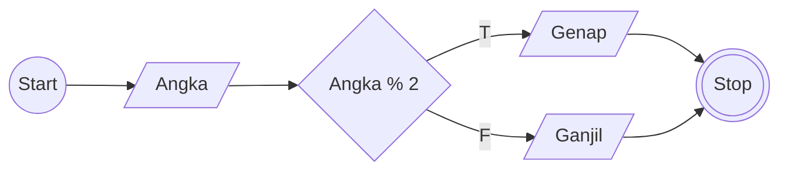
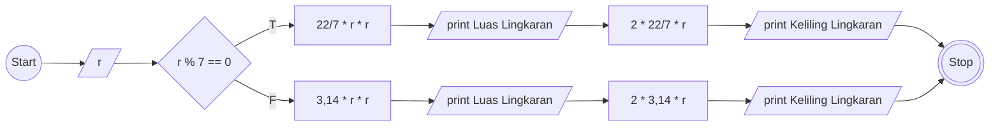

# Algoritma

## Membuat algoritma memindahkan kopi dan teh di dalam gelas
1. Mulai
1. Siapkan gelas kosong (x), gelas berisi teh (a) dan gelas berisi kopi (b)
1. Pindahkan teh atau kopi ke gelas kosong (x)
1. Jika teh pindah ke gelas kosong (x), maka masukan kopi ke gelas bekas teh (a)
1. Jika kopi pindah ke gelas kosong (x), maka masukan teh ke gelas bekas kopi (b)
1. Jika kopi masih di gelas yang sama (b), maka pindahkan kopi ke gelas bekas teh (a)
2. Jika teh masih di gelas yang sama (a), maka pindahkan teh ke gelas bekas kopi (b)
1. Selesai

## Membuat algoritma menentukan bilangan ganjil atau genap

### Deskriptif
1. Mulai
1. Siapkan satu buah angka bilangan bulat positif (angka) dengan anggota dari 1 sampai tak terhingga;
1. Bagi angka tersebut (angka) dengan angka 2;
1. Jika hasil pembagian merupakan bilangan bulat positif, maka bilangan (angka) adalah bilangan ganjil; Jika hasil pembagian merupakan bilangan desimal, maka bilangan (angka) merupakan bilangan ganjil;
1. Selesai

### Flowchart


### Pseudo-code

```
DECLARE Angka : INTEGER

INPUT Angka

IF Angka MOD 2 = 0 THEN
    OUTPUT "Genap"
ELSE
    OUTPUT "Ganjil"
ENDIF
```

## Membuat algoritma menghitung luas dan keliling lingkaran

### Deskriptif
1. Mulai
1. Masukan angka jari-jari (r)
1. Jika angka jari-jari (r) bisa dibagi 7, maka pi = 22/7; Jika angka jari-jari (r) bisa dibagi 7, maka pi = 3,14;
1. Print Luas Lingkaran
1. Jika pi = 22/7, maka luas lingkaran adalah 22 dibagi 7 (pi) dikali jari-jari (r) dikali jari-jari (r); Jika pi = 3,14, maka luas lingkaran adalah 3,14 (pi) dikali jari-jari (r) dikali jari-jari (r)
1. Keliling lingkaran adalah 2 dikali 22 dibagi 7 (pi) dikali jari-jari (r)
1. Print Keliling Lingkaran
1. Selesai

### Flowchart


### Pseudo-code

```
DECLARE r : INTEGER
DECLARE piA : INTEGER
DECLARE piB : INTEGER

LuasLingkaranA <- piA * r * r
LuasLingkaranB <- piB * r * r

IF r MOD 7 = 0 THEN
    LuasLingkaranA <- piA * r * r
ELSE
    LuasLingkaranB <- piB * r * r
ENDIF

KelilingLingkaran <- 2 * piA * r

OUTPUT LuasLingkaranA
OUTPUT LuasLingkaranB
OUTPUT KelilingLingkaran
```