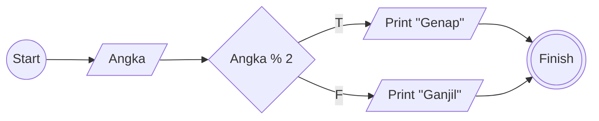
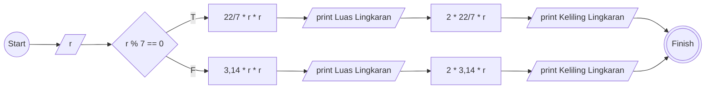

# Algoritma

## Membuat algoritma memindahkan kopi dan teh di dalam gelas
1. Mulai
1. Siapkan gelas kosong (x), gelas berisi teh (a) dan gelas berisi kopi (b)
1. Pindahkan teh atau kopi ke gelas kosong (x)
1. Jika teh pindah ke gelas kosong (x), maka masukan kopi ke gelas bekas teh (a)
1. Jika kopi pindah ke gelas kosong (x), maka masukan teh ke gelas bekas kopi (b)
1. Jika kopi masih di gelas yang sama (b), maka pindahkan kopi ke gelas bekas teh (a)
2. Jika teh masih di gelas yang sama (a), maka pindahkan teh ke gelas bekas kopi (b)
1. Selesai

## Membuat algoritma menentukan bilangan ganjil atau genap

### Deskriptif
1. Mulai
1. Siapkan satu buah angka bilangan bulat positif (a) dengan anggota dari 1 sampai tak terhingga;
1. Bagi angka tersebut (a) dengan angka 2;
1. Jika hasil pembagian merupakan bilangan bulat positif, maka bilangan (a) adalah bilangan ganjil; Jika hasil pembagian merupakan bilangan desimal, maka bilangan (a) merupakan bilangan ganjil;
1. Selesai

### Flowchart

## Membuat algoritma menghitung luas dan keliling lingkaran

### Deskriptif
1. Mulai
1. Masukan sebuah angka jari-jari (r)
1. Angka 22 dibagi 7 adalah (pi)
1. Luas lingkaran adalah 22 dibagi 7 (pi) dikali jari-jari (r) dikali jari-jari (r)
1. Keliling lingkaran adalah 2 dikali 22 dibagi 7 (pi) dikali jari-jari (r)
1. Selesai

### Flowchart

